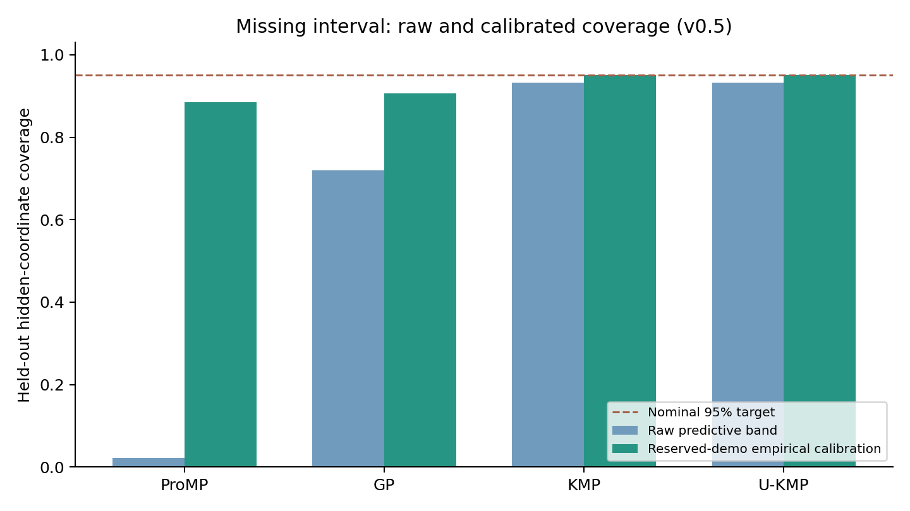
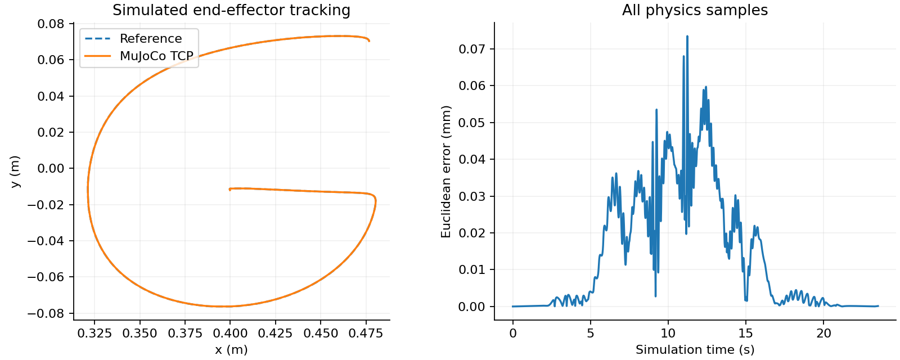

# v0.5 research validation

These are newly computed results, separate from the original dissertation and
the archived `examples/validated_run/` and `examples/robot_validation/` records.

| Stage | Configuration and scope | Recorded outcome |
|---|---|---|
| Full learning evaluation | `configs/research.json`, A-H, 105 whole demonstrations, five outer folds, five methods, three tasks | 1,575 valid records, zero execution errors |
| Default one-command demo | `configs/demo.json`, 80 samples, first outer fold; same duration per letter; fixed LQR for ordinary methods, covariance LQR for U-KMP | 345 learning records; 40/40 robot tracking checks passed |
| Force-control study | Same demo KMP path for each letter, fixed/covariance LQR, common duration, identical 0.02 N x-force pulse | 16/16 declared tracking checks passed; deflection and control effort retained |

Maximum TCP error across the default 40-case demo was 0.41235 mm. The force
study maximum was 2.27646 mm. These are ideal teaching-model simulation values,
not manufacturer specifications or physical robot precision measurements.

## Uncertainty results

Held-out hidden-coordinate coverage, averaged across the 105 outer-test demos:

| Method | Raw band | Empirically calibrated band |
|---|---:|---:|
| ProMP | 2.12% | 88.46% |
| GP | 71.94% | 90.58% |
| KMP | 93.23% | 95.04% |
| U-KMP | 93.23% | 95.04% |

DMP has no probabilistic interval. Calibration uses reserved whole outer-training
demonstrations, excluded from model and scaler fit. The reported values are
achieved test coverage, not guaranteed levels. Lower-than-nominal coverage is
preserved. The previous v0.4 run used a different adaptation/calibration protocol;
these numbers must not be presented as a controlled single-factor improvement
over that historical table.





## Files and independent checks

- `learning_metrics.csv`: every test case, including task failures, raw/calibrated
  coverage, probability scores and timing.
- `learning_summary.csv`: unfiltered method/task summaries.
- `learning_manifest.json`: effective configuration, input/source SHA-256,
  environment and timestamps. Source hashes match the v0.5 implementation used
  for the calculations; the run began before its publishing commit, so its Git
  revision is the parent and the worktree is honestly recorded as dirty.
  The matching numerical implementation was published in commit
  `2dfcffece2451df10e11b34302804df62de8bd0a`. A subsequent Windows console
  compatibility fix changes progress-message encoding, not these calculations;
  the original source hashes and numerical records remain preserved.
- `calibration_splits.json` and `calibration.json`: 40 disjoint fit/calibration/test
  partitions and 320 method/scenario calibration records.
- `demo_robot_summary.csv` and `force_control_summary.csv`: all actual simulated
  cases, controller identities, common durations, error, control effort and
  criteria.
- `audit.json`: 1,575 saved predictions independently rechecked for coordinate
  RMSE, endpoint error and gap RMSE; partitions and simulator TCP errors checked.
- `snapshot.json`: file checksums for this snapshot.

The local suite ran 43 cases: 42 passed, with the opt-in real-browser case run
in its separate Chrome CI job. Regression checks include independent full-state
KMP equations, covariance-parameter mean invariance, bad-gap rejection, GP
new-observation noise, interrupted-fold recovery, whole-workflow reuse and
actual force-dependent MuJoCo response. Check the publishing PR's CI status
for Linux, Windows and real-browser execution results.

## Reproduce

```bash
python -m pip install -e ".[simulation]"
python -m unittest discover -s tests -v
python -m imitation_learning run --config configs/research.json --output outputs/research-recheck
python -m imitation_learning demo --output outputs/demo-recheck
python -m imitation_learning simulate outputs/demo-recheck/learning --all-letters --method KMP --controllers fixed_lqr covariance_lqr --disturbance-force 0.02 0 --output outputs/control-recheck
```

Full-rate NPZ/CSV logs are generated by these commands; large per-case logs and
HTML pages are not duplicated in this snapshot. No real robot validation,
complete-arm environment obstacle test or sensor-delay robustness is implied.
