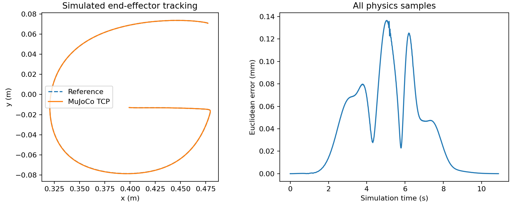

# MuJoCo 机械臂仿真检查

教学用两关节平面臂执行 A–H、五种方法各一个轨迹复现代表案例，共 **40 个案例，40 个满足预设跟踪标准，0 个运行错误**。这不是 1,575 条五折机器人评测，也不是实机实验。

- 使用 MuJoCo 3.16.0，默认 `RobotConfig`；准确参数和输入哈希见 `manifest.json`。
- 所有案例最大末端欧氏误差的最大值为 **0.272740 mm**；预设阈值为 5 mm。关节位置、实际速度/加速度及接触检查也全部通过。
- 每个案例的完整物理 NPZ 日志均独立重算 RMSE 和最大误差，与 `summary.csv` 一致。
- 这些误差是理想教学模型的跟踪误差，不是对真实机械臂精度的测量或承诺。

复现：

```bash
python -m pip install -e ".[simulation]"
python -m imitation_learning run --config configs/benchmark.json --output outputs/full
python scripts/validate_robot.py --run outputs/full --output outputs/robot-validation
```

输出包含所有案例的 `traces/*.npz`；这些可再生成的完整日志不重复提交到仓库。失败和运行异常均保存在汇总中。

单独生成可播放页面：

```bash
python -m imitation_learning simulate examples/validated_run --letter G --method KMP --output outputs/robot-g
```

下面是 G/KMP 的跟踪曲线。学习轨迹的误差与机械臂跟踪该参考的误差是两个不同阶段；KMP/U-KMP 在此使用相同固定 PD，并未验证协方差驱动的机械臂控制。


