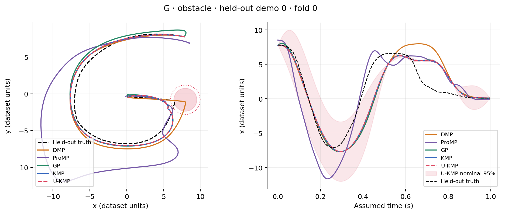
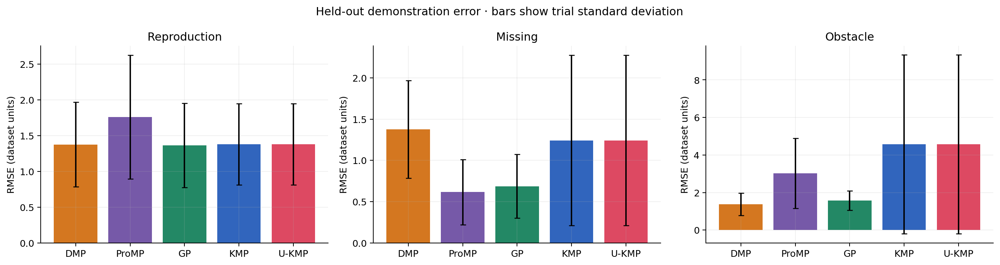

# Recomputed validation example

This directory contains the full A–H, five-fold result tables: **1,575 trials with zero execution errors**. The 240 control-ablation rows are separate from the planning table.

`dashboard.html` and `examples.json` show **G example trajectories only**, while their summary tables retain the complete A–H results. Download the HTML file and open it locally, or run:

```bash
python -m imitation_learning serve examples/validated_run
```

To regenerate the full set of example letters and every per-trial NPZ prediction, run the full benchmark into a new output directory:

```bash
python -m imitation_learning run --config configs/benchmark.json --output outputs/full
```

The checked-in package omits the approximately 45 MB per-trial NPZ tree; all saved predictions were audited against the CSV before this example was prepared. `metrics.csv`, `fold_metrics.csv`, `splits.json` and `manifest.json` preserve measurements and provenance. Model parameters are fixed before evaluation; valid poor results are not removed.




